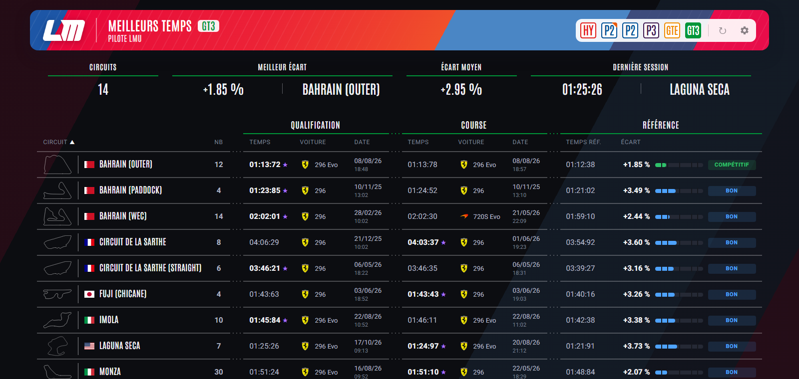

# LMU Chrono

[English](README.md) · **Français**

Tableau de bord de vos **meilleurs temps au tour sur Le Mans Ultimate**, par classe et par circuit, dans le style de
l'interface du jeu. Vos temps y sont comparés aux temps de référence de la communauté.



- **Une page par classe** (Hypercar, LMP2, LMP2 ELMS, LMP3, LMGTE, LMGT3), avec le meilleur tour en qualification et en
  course pour chaque circuit, la voiture utilisée et la date.
- **L'écart au temps de référence** de chaque circuit, avec un niveau : Élite, Compétitif, Bon, Milieu…
- **Un badge « NEW »** à côté des temps améliorés depuis votre dernière actualisation.
- **Un résumé en tête de page** : meilleur écart, écart moyen, dernière session. Un clic sur un encart mène à la ligne
  concernée, ou trie par écart.
- **Thèmes clair et sombre**, et **interface en français ou en anglais**, au choix dans les réglages.
- **Rien à configurer** : le jeu et votre nom de pilote sont détectés automatiquement. Ils restent modifiables
  dans les réglages.

## Installation

1. Téléchargez **`LMU-Chrono.exe`** depuis la page
   [Releases](../../releases/latest) du dépôt. Python n'est pas nécessaire.
2. Rangez-le où vous voulez (par exemple dans `Documents`), puis lancez-le par un double-clic.
3. Windows peut afficher « Windows a protégé votre ordinateur », car l'exécutable n'est pas signé.
   Cliquez sur **Informations complémentaires**, puis sur **Exécuter quand même**.

Au premier lancement, un raccourci **LMU Chrono** est créé sur le bureau. Le tableau de bord s'ouvre ensuite dans
votre navigateur.

> **Conseil** : lancez Le Mans Ultimate (le menu principal suffit) avant le premier lancement du tableau de bord.
> Les tracés des circuits sont fournis par le jeu pendant qu'il tourne. Sinon, la page vous le rappellera :
> lancez le jeu, puis cliquez sur ↻.

## Utilisation

- **Ouvrir le tableau de bord** : double-clic sur le raccourci du bureau. LMU Chrono ne tourne pas en permanence :
  relancez-le quand vous voulez consulter vos temps, il ajoute alors vos dernières sessions.
- **L'icône près de l'horloge** (zone de notification, parfois cachée derrière la flèche ^) indique que LMU Chrono
  tourne. Son menu permet d'**ouvrir le tableau de bord**, d'**actualiser les données**, d'**ouvrir le dossier des
  données** et de **quitter**.
- **Après une session de jeu**, page ouverte : cliquez sur **↻** en haut à droite pour ajouter vos nouveaux temps.
- **Changer de classe** : cliquez sur les badges en haut à droite (HY, P2, P3, GTE, GT3). Un clic sur un titre de
  colonne trie le tableau.
- **Réglages** : la roue crantée en haut à droite permet de choisir la **langue** (drapeaux) et le **thème**, de
  saisir votre **nom de pilote** et le **dossier du jeu**, ou de désinstaller LMU Chrono.
- **Où sont mes données ?** Dans `%LOCALAPPDATA%\LMU Chrono` (menu de l'icône > *Ouvrir le dossier des données*),
  avec le journal `lmu-chrono.log`, utile en cas de problème.

Seules les **qualifications et courses** sont prises en compte, hors ligne comme en ligne. Les temps viennent des
fichiers de résultats que le jeu écrit à la fin de chaque session.

## Questions fréquentes

**« Le Mans Ultimate est introuvable »**
Le jeu est cherché dans toutes vos bibliothèques Steam. S'il n'est pas trouvé, ouvrez les réglages (roue crantée) et
choisissez son dossier avec **Parcourir…** : c'est le dossier `Le Mans Ultimate`, dans `steamapps\common`.

**Mon nom de pilote n'est pas le bon**
Le nom est déduit de vos fichiers de résultats. Pour l'imposer, saisissez-le dans les réglages (roue crantée) :
tous vos résultats sont alors relus avec ce nom.

**LMU Chrono a-t-il besoin de droits particuliers ?**
Non. Il lit les fichiers du jeu sans les modifier, n'a pas besoin des droits administrateur, et n'écrit que dans son
dossier de données.

**Mon antivirus bloque l'exécutable**
Les exécutables fabriqués avec PyInstaller sont parfois signalés à tort. Le code source est entièrement disponible
dans ce dépôt, et l'exécutable de chaque version est fabriqué automatiquement par GitHub à partir de ce code.

**Rien ne s'affiche après le double-clic**
La première mise à jour prend quelques secondes, puis la page s'ouvre. Si une erreur survient, un message s'affiche ;
les détails sont dans `%LOCALAPPDATA%\LMU Chrono\lmu-chrono.log`.

**Désinstaller**
Réglages (roue crantée) > **Désinstaller LMU Chrono…** : le programme, son raccourci et ses données sont supprimés.
Rien n'est installé ailleurs, ni dans le registre.

## Crédits et mentions

- **Temps de référence** : colonne « ~100% » du Google Sheets public
  [« LMU laptimes » d'Ohne Speed](https://docs.google.com/spreadsheets/d/e/2PACX-1vTN03UvJDm99byA6vQPZHKOCYVvfxLu1zkJAzdaKyROykzEKY2-Xl1rl1q5znZEf36m88dxMKsY2eaO/pubhtml),
  téléchargé à chaque lancement. Merci à lui pour ce travail. Si son auteur souhaite que ce lien soit retiré ou
  modifié, il le sera.
- **Logos, drapeaux, polices et tracés des circuits** : ils proviennent de *Le Mans Ultimate*. Ils sont lus
  dans l'installation du joueur, à son premier lancement, et ne sont **pas** distribués avec ce projet. Les drapeaux
  sont ceux de [flag-icons](https://github.com/lipis/flag-icons) (licence MIT), que le jeu embarque.
- Projet de fan **non officiel**, sans lien avec Motorsport Games, Studio 397 ni les ayants droit de Le Mans
  Ultimate. *Le Mans Ultimate* et les marques citées appartiennent à leurs propriétaires respectifs.

## Développement

Prérequis : Windows et Python 3.10 ou plus récent.

```bat
pip install -r requirements.txt
python lmu.py --serve --open
```

`python lmu.py --serve --open` garde une console avec les messages ; `python lmu.py --tray` reproduit l'exécutable
(icône près de l'horloge). Lancé depuis le code source, le programme garde ses données dans le dossier du projet. Les
options sont décrites en tête de [`lmu.py`](lmu.py), et `python lmu.py --help` les liste.

| Fichier | Rôle |
|---|---|
| `lmu.py` | Point d'entrée, en ligne de commande ou par double-clic sur l'exécutable. |
| `config.json` | Classes, correspondance des noms de circuits, marques. C'est ici qu'on ajoute un nouveau circuit ou une nouvelle classe. |
| `lmu_dashboard/` | Le code : `data.py` (résultats XML, base SQLite, temps de référence), `web.py` et `web_template.html` (page), `assets.py` et `trackmaps.py` (fichiers du jeu), `server.py` (actualisation, réglages), `tray.py` (icône près de l'horloge), `install.py` (raccourci, désinstallation), `i18n.py` (textes côté Python), etc. |
| `lmu_dashboard/resources/` | Icône de LMU Chrono, dessinée par `tools/make_icon.py`. |
| `build_exe.bat` | Fabrique `dist\LMU-Chrono.exe`. |

**Langues** : tout ce que voit l'utilisateur existe en français et en anglais : la page (`I18N` dans
`web_template.html`), le côté Python (`lmu_dashboard/i18n.py`) et ce README (`README.md` et `README.fr.md`, à mettre
à jour ensemble).

**Publier une version** : sur GitHub, page **Releases**, cliquez sur **Draft a new release**, créez une étiquette
(`v1.0.0`…) puis cliquez sur **Publish release**. Quelques minutes plus tard, GitHub a fabriqué l'exécutable et l'a
joint à la release ([`.github/workflows/release.yml`](.github/workflows/release.yml)).

## Licence

[MIT](LICENSE) : vous pouvez utiliser, modifier et redistribuer ce code librement, en conservant la mention de licence.
