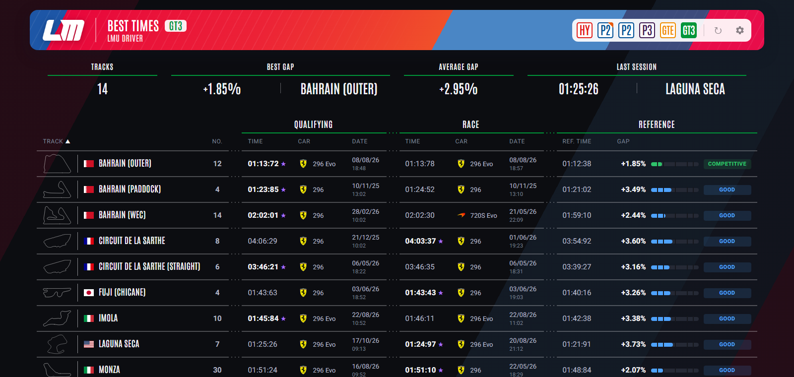

# LMU Chrono

**English** · [Français](README.fr.md)

A dashboard of your **best lap times in Le Mans Ultimate**, per class and per track. 
Your times are compared with the community's reference times.



- **One page per class** (Hypercar, LMP2, LMP2 ELMS, LMP3, LMGTE, LMGT3), with your best lap in qualifying and in the
  race for each track, the car you used and the date.
- **The gap to the reference time** of each track, with a level: Elite, Competitive, Good, Midpack…
- **A “NEW” badge** next to the times you improved since your last refresh.
- **A summary at the top**: best gap, average gap, last session. Click a tile to jump to the matching row, or to
  sort by gap.
- **Light and dark themes**, and an **English / French interface**, switchable in the settings.
- **Nothing to configure**: the game and your driver name are detected automatically. Both can still be changed in
  the settings.

## Installation

1. Download **`LMU-Chrono.exe`** from the repository's [Releases](../../releases/latest) page. Python is not needed.
2. Put it anywhere you like (for example in `Documents`) and double-click it.
3. Windows may show “Windows protected your PC”, because the executable is not signed. Click **More info**, then
   **Run anyway**.

On first launch, a **LMU Chrono** shortcut is created on your desktop. The dashboard then opens in your browser.

> **Tip**: start Le Mans Ultimate (the main menu is enough) before the first launch of the dashboard. The track maps
> are provided by the game while it is running. If they are missing, the page reminds you: start the game, then
> click ↻.

## Usage

- **Open the dashboard**: double-click the desktop shortcut. LMU Chrono does not run all the time: launch it again
  whenever you want to look at your times, and it adds your latest sessions.
- **The icon near the clock** (notification area, sometimes hidden behind the ^ arrow) shows that LMU Chrono is
  running. Its menu lets you **open the dashboard**, **refresh the data**, **open the data folder** and **quit**.
- **After a gaming session**, with the page open: click **↻** at the top right to add your new times.
- **Switch class**: click the badges at the top right (HY, P2, P3, GTE, GT3). Click a column title to sort the table.
- **Settings**: the gear at the top right lets you choose the **language** (flags) and the **theme**, set your
  **driver name** and the **game folder**, or uninstall LMU Chrono.
- **Where is my data?** In `%LOCALAPPDATA%\LMU Chrono` (icon menu > *Open the data folder*), together with the
  `lmu-chrono.log` log file, useful if something goes wrong.

Only **qualifying sessions and races** are counted, offline or online. The times come from the result files the game
writes at the end of every session.

## FAQ

**“Le Mans Ultimate not found”**

The game is searched for in all your Steam libraries. If it is not found, open the settings (gear) and choose its
folder with **Browse…**: it is the `Le Mans Ultimate` folder, inside `steamapps\common`.

**My driver name is wrong**

The name is deduced from your result files. To force it, type it in the settings (gear): all your results are then
re-read with that name.

**Does LMU Chrono need special permissions?**

No. It reads the game files without modifying them, does not need administrator rights, and only writes to its own
data folder.

**My antivirus blocks the executable**

Executables built with PyInstaller are sometimes flagged by mistake. The complete source code is in this repository,
and the executable of each version is built automatically by GitHub from that code.

**Nothing appears after the double-click**

The first update takes a few seconds, then the page opens. If an error occurs, a message is shown; the details are
in `%LOCALAPPDATA%\LMU Chrono\lmu-chrono.log`.

**Uninstall**

Settings (gear) > **Uninstall LMU Chrono…**: the program, its shortcut and its data are deleted. Nothing is installed
anywhere else, not even in the registry.

## Credits and notices

- **Reference times**: the “~100%” column of the public Google Sheets
  [“LMU laptimes” by Ohne Speed](https://docs.google.com/spreadsheets/d/e/2PACX-1vTN03UvJDm99byA6vQPZHKOCYVvfxLu1zkJAzdaKyROykzEKY2-Xl1rl1q5znZEf36m88dxMKsY2eaO/pubhtml),
  downloaded at every launch. Thanks for this work. If the author would like this link removed or changed, it will
  be.
- **Logos, flags, fonts and track maps**: they come from *Le Mans Ultimate*. They are read from the player's own
  installation, on first launch, and are **not** distributed with this project. The flags are those of
  [flag-icons](https://github.com/lipis/flag-icons) (MIT license), which the game embeds.
- **Unofficial** fan project, not affiliated with Motorsport Games, Studio 397 or the rights holders of Le Mans
  Ultimate. *Le Mans Ultimate* and the brands mentioned belong to their respective owners.

## Development

Requirements: Windows and Python 3.10 or newer.

```bat
pip install -r requirements.txt
python lmu.py --serve --open
```

`python lmu.py --serve --open` keeps a console with the messages; `python lmu.py --tray` reproduces the executable
(icon near the clock). Run from the source code, the program keeps its data in the project folder. The options are
described at the top of [`lmu.py`](lmu.py), and `python lmu.py --help` lists them.

| File | Role |
|---|---|
| `lmu.py` | Entry point, from the command line or by double-clicking the executable. |
| `config.json` | Classes, track name mapping, brands. This is where a new track or class is added. |
| `lmu_dashboard/` | The code: `data.py` (XML results, SQLite database, reference times), `web.py` and `web_template.html` (page), `assets.py` and `trackmaps.py` (game files), `server.py` (refresh, settings), `tray.py` (icon near the clock), `install.py` (shortcut, uninstall), `i18n.py` (texts of the Python side), etc. |
| `lmu_dashboard/resources/` | The LMU Chrono icon, drawn by `tools/make_icon.py`. |
| `build_exe.bat` | Builds `dist\LMU-Chrono.exe`. |

**Languages**: everything the user sees exists in French and English: the page (`I18N` in `web_template.html`), the
Python side (`lmu_dashboard/i18n.py`), and this README (`README.md` and `README.fr.md`, to be updated together).

**Publishing a version**: on GitHub, go to **Releases**, click **Draft a new release**, create a tag (`v1.0.0`…), then
click **Publish release**. A few minutes later GitHub has built the executable and attached it to the release
([`.github/workflows/release.yml`](.github/workflows/release.yml)).

## License

[MIT](LICENSE): you may use, modify and redistribute this code freely, as long as you keep the license notice.
